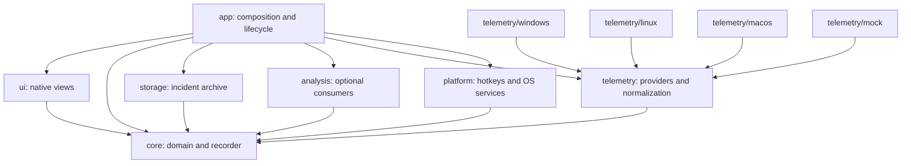
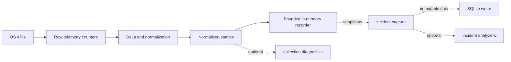
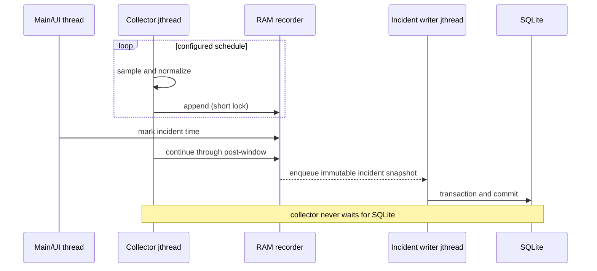

# BlackBox architecture

## Architectural goals

BlackBox records enough recent system behavior to explain transient incidents while remaining measurably cheaper than the workloads it observes. The design isolates OS APIs, bounds memory, performs no normal recording-time database writes, and keeps optional consumers out of the collection path.

## Modules and dependency rules

Rules:

1. `core` owns platform-independent domain types, recorder behavior, clocks, and diagnostics contracts. It cannot include SDL, SQLite, ImGui, or OS headers.
2. `telemetry` owns raw counters, provider contracts, normalization, and provider capabilities. Only OS-specific subdirectories may include Win32, `/proc`, or Mach headers.
3. `platform` owns OS services that are not telemetry, notably global hotkeys. It follows the same interface/implementation split.
4. `storage` accepts immutable incident snapshots. It cannot poll telemetry or block the collector.
5. `analysis` consumes normalized incidents. Collection and recording cannot depend on analysis.
6. `ui` observes core state and emits commands. The recorder cannot depend on UI lifetime or frame rate.
7. `app` is the composition root and may depend on all modules to wire concrete implementations.

`windows.h` is forbidden outside Windows implementation directories unless an exception is documented. Unsupported metrics are data, not failures: callers consult `PlatformCapabilities` and tolerate absent values.

## Telemetry pipeline

Raw provider output preserves cumulative counter precision and a monotonic observation time. The normalization layer compares consecutive observations, rejects invalid intervals, handles resets/wraps, and produces explicit units such as fraction, bytes/second, and operations/second. The recorder sees only normalized, platform-independent values.

Static `ProcessInfo` is separated from time-series `ProcessSample`. Metadata is cached and refreshed on process lifecycle changes or a slow tier, never resolved every fast sample. Process identity combines PID with a creation-time token to prevent PID reuse from merging unrelated processes.

Sampling tiers are a scheduler concern, not a property of the normalized sample schema:

- Fast: CPU, disk, and network counters.
- Normal: memory and process activity.
- Slow/event-driven: process paths and system metadata.

`ITelemetryProvider::sample` writes into a caller-owned `RawTelemetrySnapshot`, clearing logical contents while retaining vector capacity. `SamplingRequest` carries a set of fast, normal, and slow tiers without introducing a scheduler. Providers report a coarse sample result while each metric independently carries `available`, `unsupported`, `inaccessible`, or `temporarily_unavailable` state.

Normalized units are explicit value types: `Ratio` is a fraction in `[0,1]`, `ByteCount` is bytes, and `BytesPerSecond` is bytes/second. CPU counters contain cumulative busy and total ticks in a common provider-defined tick unit. CPU utilization is `busy_delta / total_delta`, representing the fraction of total machine capacity busy during the interval. The Windows provider derives busy ticks as total minus idle before emitting raw data.

`ProcessIdentity` combines PID and a provider creation token. `ProcessInfo` owns slow metadata; `RawProcessCounters` and `ProcessSample` contain time-varying data. Normalization tracks deltas by full process identity and preserves unavailable states.

Opt-in process lifecycle evidence remains on the same boundary: the Windows provider derives
start/exit observations from its existing full-identity enumeration, and the portable collector
may forward only normalized `(PID, creation token, kind, monotonic time)` records through an
`ISystemEventSink` into the separate bounded event recorder. Initial inventory and uncertain
resynchronization observations are suppressed. The event cannot request capture, alter anomaly or
contributor scores, or manufacture a diagnosis. Incident construction joins in-window context and
referenced metadata; downstream contributor output may report an exact identity-matched start/exit
time separately from anomalous-activity onset. This adds no storage, UI, analysis, or second
native-enumeration dependency to the collection path.

## Recorder pipeline

The recorder is a fixed-capacity ring buffer sized from history duration and base interval (initially 300 samples for five minutes at one second). Capacity is fixed during a recording configuration epoch. Appends overwrite the oldest sample in constant time. Snapshot extraction returns samples in chronological order.

The first implementation uses `std::mutex` around short recorder operations. Lock-free structures are prohibited until benchmarks show contention is material. UI readers receive copied or immutable snapshots rather than holding the collector lock while rendering.

The recorder does not know about SQLite, views, or analyzers. It can run headless with a provider, normalizer, clock, and scheduling loop.

## Threading model

- Main/UI thread: SDL events, native rendering, user commands. When hidden, rendering should be event-driven or aggressively throttled.
- Collector `std::jthread`: schedules sampling with a monotonic clock and cooperative stop. No SQLite or UI calls.
- Writer `std::jthread`: waits on a bounded work queue, writes one transaction per incident, and reports failures without crossing the thread boundary with exceptions.
- Viewer `std::jthread`: performs paginated archive queries, selected-incident loads, annotation updates, and large view-model construction; the render loop consumes immutable display snapshots and never calls SQLite.

Shutdown order stops new captures, requests collector stop, joins it, drains or explicitly cancels writer work according to policy, joins the writer, closes SQLite, then destroys UI/platform resources. Ownership is RAII and rooted in `app`.

## Incident pipeline

A manual capture records event time `T`, retains the requested pre-window, and waits for the post-window. Defaults are `T - 120 s` through `T + 30 s`. Completion creates an immutable value object containing metadata, normalized system samples, referenced process metadata, and process samples. Overlapping pending captures merge their requested windows. The coordinator bounds queued and constructing snapshots to two slots; the writer owns at most one additional in-flight snapshot.

The global hotkey is exposed through an `IGlobalHotkeyManager`-style platform interface. Its callback emits a core command; Win32 message-loop details remain in `platform/windows`.

## Storage architecture

SQLite is an incident archive, never the live recorder. Logical tables hold schema metadata, incidents, system samples, process identities/metadata, and process samples. Before the first public release the complete layout is created directly as schema version 1 and non-v1 archives are rejected unchanged. Prepared statements insert one whole incident per transaction, so a failure rolls back every row from that attempt.

The pre-release direct-v1 rule is also a build contract. A platform-independent CTest check pins the
archive schema plus all eleven persisted settings/export/evaluation format constants to version 1,
requires exactly one `PRAGMA user_version=1` schema publication, and rejects production migration,
legacy-reader, compatibility-reader, or alternate-schema tokens. Behavioral tests separately prove
that valid product and recorder settings rewritten as format 2 are rejected rather than converted.
This guard is downstream test infrastructure and introduces no runtime dependency.

Database errors produce observable incident-writer status and leave the collector running. The archive uses WAL with `synchronous=FULL`, a 1 GiB default logical growth limit, and no automatic deletion or corrupt-database replacement. `docs/STORAGE.md` specifies the schema, location, durability, size, and recovery contracts.

Direct V1 identity is the complete canonical SQLite layout, not only `PRAGMA user_version`. On every
open, storage constructs the current schema in an isolated in-memory connection and compares the
ordered non-internal table/index definitions, application ID, metadata row, and required singleton
control state with the candidate archive. Restore performs the same comparison through a read-only
source connection before it creates a safety copy or changes the active archive. Missing, extra, or
altered development objects are rejected unchanged for explicit recreation; there is no conversion
or compatibility path. This is open/maintenance work and never enters normal recording or the
collector dependency graph.

## Platform abstraction

Provider selection happens in `app`. Core code sees capabilities and normalized values, not build macros or native handles. Windows is the intended first product target; no platform is yet release-qualified. Mock scenarios support deterministic development on every build host. Linux has an engineering provider for system CPU/memory/disk/network/power/uptime, capability-driven GPU evidence, and process CPU/memory/I/O behind the same interface. Its native desktop target and explicitly labeled TGZ, DEB, and RPM engineering packages are built, measured, extracted, and smoke-tested across Ubuntu, Debian, and Fedora hosted containers. Linux platform services supply a native SDL tray boundary, a per-user instance lock, exact XDG autostart ownership, bounded freedesktop notifications, a Wayland global-shortcut boundary, and nonblocking increased-contrast/reduced-motion reads through the XDG Desktop Portal. Unavailable desktop protocols keep the window visible and remain explicit. macOS has an engineering provider for system CPU/memory/disk/network/power/uptime and process CPU/memory/I/O using Mach, sysctl, libproc, BSD interface counters, and IOKit behind the same telemetry interface. It exposes public non-identifying Metal inventory and render-device availability, but not passive whole-system GPU utilization. All native APIs remain confined to `telemetry/<os>` or `platform/<os>` and neither backend changes the collector dependency graph. These are hosted engineering boundaries, not physical qualification or product-support claims.

Optional platform evidence stays narrower than this shared graph. A wlroots Wayland reader may expose
only a session-scoped opaque foreground application key; it discards titles and raw application IDs
and never guesses a PID. macOS exposes a separate coarse memory-pressure state and BlackBox's own
login-item authorization status, but neither Linux PSI semantics nor system-wide service activity.

Provider semantics, supported metrics and native API references are maintained in [Telemetry](docs/TELEMETRY.md) and [Platform parity](docs/PLATFORM_PARITY.md).

## Optional analysis boundary

Analysis consumes immutable normalized incidents downstream of collection. The implemented local statistical pipeline includes personalization, context, contributors, recurrence and calibrated uncertainty. [Analysis](docs/ANALYSIS.md) defines those contracts. Statistical baselines precede ML. Optional ONNX Runtime inference may be introduced only after evaluation demonstrates added value, and it must not enter the recorder dependency graph.

Cause candidates must use probabilistic language. Temporal correlation and anomaly magnitude are evidence, not proof of causation.

## Settings, shutdown and recovery

Ordinary preferences do not restart collection. Recording changes close capture admission before checking pending windows; accepted captures finish before disruptive changes. Capture-window changes preserve history, while cadence, history-capacity and executable-path privacy changes start a new recorder epoch.

After exhausted storage retries, the writer retains up to three immutable accepted snapshots and blocks new captures. It never evicts an older recovery item to accept a newer capture. Retry/export and explicit purge remain user-visible operations. This bound depends on the production coordinator's two slots plus one writer-owned snapshot.

Normal user exit closes capture admission, offers draft saving, waits for accepted maintenance and mutations, and drains the writer asynchronously before rechecking recovery. Explicit discard and operating-system session termination are separate paths. Forced termination cannot guarantee preservation of RAM-only captures.

File-backed backups use a separate read-only SQLite transaction for a consistent WAL snapshot, then copy in bounded batches without holding the active archive mutex. Verification and exclusive publication follow copying. Cancellation and a two-minute operation deadline bound cooperative work; an operating-system filesystem stall is not a hard real-time guarantee. Restore remains an exclusive archive boundary with a verified safety copy.

## UI and accessibility boundary

The main thread alone owns ImGui. Windows UI Automation reads immutable, bounded semantic snapshots and queues validated actions back to that thread. Providers do not retain widget pointers. The bridge exposes names, values, focus and basic control patterns; physical Narrator qualification remains required. Linux/macOS do not inherit this Windows provider.

See [Storage](docs/STORAGE.md), [Configuration](docs/CONFIGURATION.md), [Testing](docs/TESTING.md), and [Current candidate](docs/CURRENT_CANDIDATE.md) for operational contracts and evidence limits.
